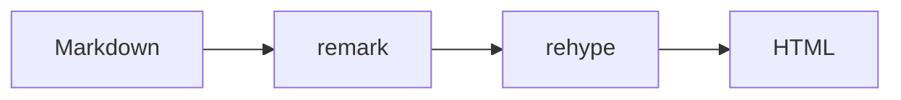
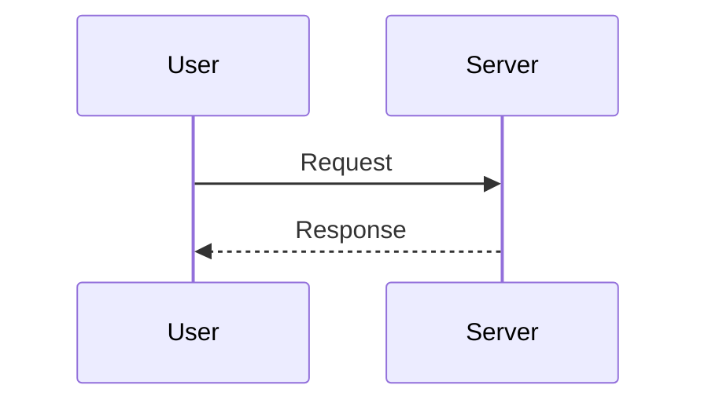
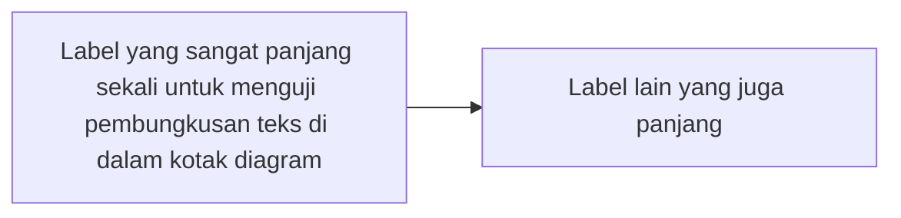

import TidakDipakai from "./tidak-ada";

Halaman ini menguji semua yang bisa muncul di blog. Kalau ada bagian yang tampak aneh, itu bahan perbaikan pipeline, bukan salah tulis.

## Teks Inline

Paragraf biasa dengan **bold**, *italic*, ***bold dan italic***, ~~strikethrough~~, dan `inline code`.

Inline code berisi karakter aneh: `` `backtick` ``, `$HOME`, `{kurung kurawal}`, `<tag>`, dan `a | b`.

Link [internal](/about) dan [eksternal](https://example.com). Link dengan judul: [contoh](https://example.com "Judul link").

Autolink telanjang: https://example.com dan email halo@example.com.

Baris pertama dengan hard break\
baris kedua setelah hard break.

HTML entity: &amp; &copy; &nbsp;selesai.

Emoji dan unicode: 🚀 café naïve 日本語.

Escape: \*bukan italic\*, \_bukan italic\_, \[bukan link\]. Referensi catatan kaki pertama.[^1]

## Heading

# Heading Satu di Body

## Heading Dua

### Heading Tiga

#### Heading Empat

##### Heading Lima

###### Heading Enam

## Heading dengan `Inline Code`

## Heading dengan [Link](/about) dan *Emphasis*

## Heading dengan tanda tanya? Dan koma, titik.

## Emoji 🚀 dan unicode café

## Heading dengan math $a^2 + b^2 = c^2$

## Heading yang sengaja dibuat sangat panjang sekali supaya terlihat bagaimana teks membungkus di dalam kolom artikel yang lebarnya tujuh ratus piksel ini

## Duplicate Heading

## Duplicate Heading

### Heading setelah duplicate tanpa paragraf

## List

- Item pertama
- Item kedua dengan `inline code`
- Item ketiga dengan [link](/blog)

1. Langkah satu
2. Langkah dua
3. Langkah tiga

- Level satu
  - Level dua
    - Level tiga
      - Level empat

1. Ordered satu
   1. Ordered dua
      1. Ordered tiga

1. Campuran
   - anak unordered
     1. cucu ordered
2. Item kedua

- Item longgar pertama

- Item longgar kedua

- Item longgar ketiga

- Item dengan kode:

  ```ts
  const x = 1;
  ```

- Item dengan dua paragraf.

  Paragraf kedua di dalam item yang sama.

- [x] Tugas selesai
- [ ] Tugas belum
  - [x] Anak tugas selesai
  - [ ] Anak tugas belum

## Blok

> Kutipan biasa.

> > Kutipan bersarang.

> Kutipan dengan list:
>
> - satu
> - dua

---

<div className="border border-border-hairline p-4 my-6">
  Blok JSX dengan elemen div.
</div>

<details>
  <summary>Detail yang bisa dibuka</summary>
  Isi di dalam details.
</details>

*Fig 1. Pola caption memakai paragraf italic.*

## Tabel

| Kolom A | Kolom B |
|---|---|
| Isi A | Isi B |

| Kiri | Tengah | Kanan |
|:---|:---:|---:|
| satu | dua | tiga |
| `kode` | [link](/about) | |

| Satu | Dua | Tiga | Empat | Lima | Enam | Tujuh |
|---|---|---|---|---|---|---|
| sel panjang sekali yang harusnya membuat tabel ini butuh scroll horizontal di layar kecil | b | c | d | e | f | g |

| Hanya Header | Kolom Kedua |
|---|---|

| Math A | Math B |
|---|---|
| $x^2$ | $y^2$ |

## Kode

```php
<?php
echo "halo";
```

```ts
const harga = "$5";
const total = 10;
```

```bash
echo "$HOME"
```

```json
{ "a": 1, "b": [2, 3] }
```

```
Fence tanpa bahasa.
```

```ts title="contoh.ts"
const berjudul = true;
```

```ts {1,3}
const satu = 1;
const dua = 2;
const tiga = 3;
```

```ts
const barisPanjang = "ini baris yang sengaja dibuat sangat panjang sekali supaya kita bisa melihat apakah blok kode melakukan scroll di dalam kotaknya sendiri tanpa membuat seluruh halaman ikut melebar ke samping";
```

```
```

Kode dengan karakter khusus: `<div>`, `a & b`, `x > y`.

## Math

Inline math $E = mc^2$ dan $O(n \log n)$.

$$
T(n) = 2T\left(\frac{n}{2}\right) + O(n)
$$

$$
\begin{aligned}
(a + b)^2 &= a^2 + 2ab + b^2 \\
(a - b)^2 &= a^2 - 2ab + b^2
\end{aligned}
$$

Math dengan perbandingan $x < y$ dan $a \& b$.

Harga $5 dan $10 tidak boleh menjadi math. Math di catatan kaki juga diuji.[^math]

$$
\sum_{i=1}^{n} \frac{x_i^2}{\sigma_i^2} + \prod_{j=1}^{m} \left(1 + \frac{y_j}{\tau_j}\right) + \int_{0}^{\infty} e^{-t^2}\,dt = \frac{\sqrt{\pi}}{2} + \cdots
$$

## Gambar


<BlogImage
  src="https://images.unsplash.com/photo-1555066931-4365d14bab8c?q=80&w=1200&auto=format&fit=crop"
  alt="BlogImage dengan dimensi"
  width="1200"
  height="800"
/>

<BlogImage
  src="https://images.unsplash.com/photo-1555066931-4365d14bab8c?q=80&w=1200&auto=format&fit=crop"
  alt="BlogImage dengan prop ekspresi"
  width={1200}
  height={800}
/>

<BlogImage
  src="https://images.unsplash.com/photo-1555066931-4365d14bab8c?q=80&w=1200&auto=format&fit=crop"
  width="1200"
  height="800"
/>

<a href="https://example.com">
  <BlogImage
    src="https://images.unsplash.com/photo-1555066931-4365d14bab8c?q=80&w=1200&auto=format&fit=crop"
    alt="Gambar di dalam link"
    width="1200"
    height="800"
  />
</a>


## Mermaid







```mermaid
flowchart LR
    A[Start] -->
```

## MDX dan JSX

Inline JSX: <span className="font-mono text-primary">teks span</span>.

JSX dengan prop string sudah diuji di bagian gambar. Prop ekspresi `width={1200}` juga sudah.

{/* komentar jsx */}

Komentar HTML `<!-- komentar -->` tidak didukung MDX. Menulisnya sebagai teks biasa akan menggagalkan build, jadi di sini hanya dicatat.

## Stress dan Edge

Kata tanpa spasi: aaaaaaaaaaaaaaaaaaaaaaaaaaaaaaaaaaaaaaaaaaaaaaaaaaaaaaaaaaaaaaaaaaaaaaaaaaaaaaaaaaaaaaaaaaaaaaaaaaaaaaaaaaaaaaaaaaaaaaaaaaaaaaaaaaaaaaaaaaaaaaaaaaaaaa.

Paragraf panjang: ini paragraf yang sengaja dipanjangkan untuk melihat ritme baris, jarak antar paragraf, dan perilaku pembungkusan teks pada kolom sempit. Kalimatnya diulang beberapa kali dengan variasi supaya tidak persis sama. Membaca paragraf panjang di layar kecil menguji lebar baris, tinggi baris, dan margin bawah. Kalau salah satu nilai itu meleset, mata akan cepat lelah. Panjang yang nyaman biasanya enam puluh sampai delapan puluh karakter per baris. Di layar lebar, kolom artikel tujuh ratus piksel sudah mendekati batas itu. Di layar ponsel, teks harus tetap terbaca tanpa scroll horizontal. Paragraf ini juga menguji apakah ada kata yang terpotong aneh atau spasi yang hilang. Kalimat demi kalimat ditambahkan sampai beberapa baris penuh. Tidak ada maksud lain selain mengisi ruang. Kalau semuanya benar, paragraf ini terlihat seperti tulisan biasa. Kalau ada yang salah, akan terlihat sebagai jarak yang janggal atau baris yang terlalu rapat. Itu tandanya token tipografi perlu dicek.


Tiga baris kosong di atas paragraf ini.

Baris dengan trailing spaces di belakang.  
Baris kedua setelah dua spasi.

## Penutup

Halaman ini selesai. Semua fitur di atas harus tampil tanpa error di console.

[^1]: Footnote pertama.

[^math]: Rumus di catatan kaki: $e^{i\pi} + 1 = 0$.
