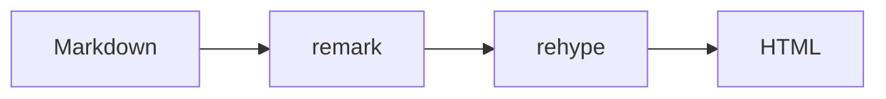

This post doubles as the reference page for the blog's Markdown pipeline. If a feature here looks wrong after a dependency update, the pipeline is broken.

## Why Math Needs Extra Plugins

Markdown has no concept of math. A `$` is just a character. Rendering LaTeX needs two plugins: one to parse the math into nodes, and one to turn those nodes into HTML. This blog uses `remark-math` and `rehype-katex`.

## Inline Math and `Code`

Inline math sits between single dollar signs, like $E = mc^2$ or the running time $O(n \log n)$. A heading with inline code still gets a clean anchor, which is what this heading tests.

## Block Equations

A block equation uses double dollar signs and gets centered on its own line.

$$
T(n) = 2T\left(\frac{n}{2}\right) + O(n)
$$

### Aligning Steps

Use an `aligned` environment when several lines belong together.

$$
\begin{aligned}
(a + b)^2 &= a^2 + 2ab + b^2 \\
(a - b)^2 &= a^2 - 2ab + b^2
\end{aligned}
$$

## GFM Extras

`remark-gfm` adds tables, task lists, strikethrough, autolinks, and footnotes.

| Feature | Plugin | Status |
|---|---|---|
| Inline math | `remark-math` | Working |
| Block math | `rehype-katex` | Working |
| Footnotes | `remark-gfm` | Working |

- [x] Inline math renders
- [x] Block math renders
- [ ] Add a chart for the complexity table

Strikethrough works too: ~~this sentence is gone~~. Footnotes land at the bottom of the post.[^1]

One catch when writing JSX here: `next-mdx-remote` strips `{...}` expressions for safety, so component props must be quoted strings. Write `<BlogImage width="1200" height="800" />`, not `width={1200}`.

> A quote block still uses the same left border as the rest of the site.

## Code and Diagrams

```ts
export function complexity(n: number): string {
  if (n < 2) return "O(1)";
  return n < 1000 ? "O(n)" : "O(n log n)";
}
```



---

That covers every element the blog styles: headings, paragraphs, tables, lists, quotes, code, diagrams, and math.

[^1]: The footnote definition lives at the end of the file and `remark-gfm` links it back to the reference.
